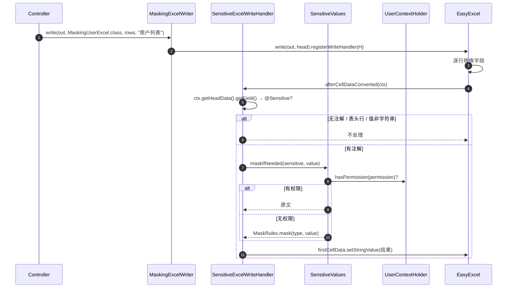

# MaskingDemoController 文件导出脱敏 —— 通用导出脱敏机制设计与实施计划

> 项目：`/Users/jay/Documents/ideaProject/demo/project-my`（`spring` 模块）
> 技术栈：Spring Boot 2.7.18 / Java 11 / Jackson / EasyExcel 4.0.3
> 本次方向（按反馈调整）：
> 1. 不再只做演示 DTO 的一次性处理，改为**可复用的 Excel 导出脱敏机制**；
> 2. **导出与查询统一脱敏**：JSON 与 Excel 共用同一套权限判定与脱敏规则（同一 `@Sensitive`、同一解析入口）；
> 3. 保留 `MaskingDemoController` 作为落地示例，并让既有 `/api/excel/users/export` 也迁移到新机制。

---

## 一、目标与验收口径

| 目标 | 验收口径 |
| --- | --- |
| 通用机制 | 任意 EasyExcel 导出模型，只要字段标注 `@Sensitive(type, permission)`，经统一入口写出即自动脱敏，无需逐模型写脱敏代码 |
| 导出/查询统一 | JSON 与 Excel 走**同一个** `SensitiveValues` 判定入口；同一权限下两种输出值完全一致 |
| 演示端点 | 新增 `GET /api/demo/masking/users/export`，导出 5 列：用户ID、用户名、邮箱、手机号、年龄 |
| 不污染数据 | 导出不修改实体或 DTO 源对象（单元格级改写，而非改写 Bean 字段） |
| 兼容既有能力 | `/api/excel/users/export`、`/api/demo/masking/users`、导入功能行为不变，既有测试全绿 |

权限矩阵（沿用现有 `PermissionCodes`）：

| 请求头 | 用户名 | 邮箱 | 手机号 |
| --- | --- | --- | --- |
| 无 / `X-Role: GUEST` | `张*` | `z***@example.com` | `138****0001` |
| `X-Role: OPERATOR` | `张三` | `z***@example.com` | `138****0001` |
| `X-Role: ADMIN` | `张三` | `zhangsan@example.com` | `13800000001` |
| `X-Role: GUEST` + `X-Permissions: user:email:read` | `张*` | `zhangsan@example.com` | `138****0001` |

---

## 二、现状分析

| 现状 | 位置 | 结论 |
| --- | --- | --- |
| 注解 `@Sensitive(type, permission)` | `masking/Sensitive.java` | 作为唯一元数据来源，JSON 与文件共用 |
| 纯函数规则 `MaskRules`（6 类） | `masking/MaskRules.java` | 已有 PHONE/EMAIL/NAME 等规则，且对已脱敏值幂等 |
| JSON 序列化器 | `masking/SensitiveJsonSerializer.java` | `createContextual` 读取 `BeanProperty` 上的注解；判定逻辑目前内联 |
| 文件场景处理器 | `masking/SensitiveDataMasker.java` | **Bean 级反射改写**，会原地修改对象；仅适合一次性副本 |
| 既有 Excel 导出 | `service/impl/ExcelServiceImpl.java#L48-L85` | 先 `maskBeans(rows)` 再写两个 Sheet；脱敏与写出耦合，且改写了 DTO |
| 演示 Controller | `controller/MaskingDemoController.java` | 仅有 `/users`（JSON）与 `/me`，无导出 |
| 权限上下文 | `masking/UserContextHolder.java`、`config/MockUserContextFilter.java` | ThreadLocal + `finally clear()`，导出线程可直接读取 |
| `User` 实体 | `entity/User.java` | 无 `phone` 字段，`@AllArgsConstructor` 被约 47 处调用；**本次不加字段** |
| `UserDTO.phone` | `dto/UserDTO.java` | 字段与 `@Sensitive(PHONE)` 已存在，当前固定传 null |

关键结论：现有 `SensitiveDataMasker` 是“写前改 Bean”，无法直接支撑“任意导出模型 + 不改源对象”。EasyExcel 4.0.3 提供 `CellWriteHandler#afterCellDataConverted(CellWriteHandlerContext)`，其中 `context.getHeadData().getField()` 可拿到字段反射信息、`context.getFirstCellData().setStringValue(...)` 可改写单元格值——足以在**单元格级别**按注解脱敏，且不触碰源对象。

---

## 三、总体设计

### 3.1 三层结构

```
                    ┌──────────────────────────────┐
   JSON 输出  ─────▶ │ SensitiveJsonSerializer      │ ─┐
                    └──────────────────────────────┘  │
                                                      ├─▶ SensitiveValues（唯一判定入口）
                    ┌──────────────────────────────┐  │      ├─ UserContextHolder.hasPermission()
   Excel 输出 ─────▶ │ SensitiveExcelWriteHandler   │ ─┘      └─ MaskRules.mask(type, value)
                    └──────────────────────────────┘
                                 ▲
                    ┌──────────────────────────────┐
   写出入口    ─────▶ │ MaskingExcelWriter（门面）    │  自动注册 WriteHandler
                    └──────────────────────────────┘
```

- **统一判定层** `SensitiveValues`：静态方法，无状态；JSON 序列化器、Excel 单元格处理器、旧的 Bean 处理器全部调用它。
- **通用写出层** `SensitiveExcelWriteHandler` + `MaskingExcelWriter`：任何 `EasyExcel.write` 经门面创建即自动挂载处理器。
- **元数据层**：继续使用 `@Sensitive`，不新增注解、不改模型继承结构。

### 3.2 为什么选 `CellWriteHandler` 而不是其他方案

| 方案 | 可行性 | 结论 |
| --- | --- | --- |
| `Converter<String>` | `WriteConverterContext` 有 `getContentProperty()`，可间接取字段 | 会替换全局 String 转换器，影响所有字符串列，风险高于收益 |
| Bean 级预改写（现有 `SensitiveDataMasker`） | 已实现 | 需要新建副本、会改源对象、与“查询统一”脱节，保留但降为可选工具 |
| AOP 拦截 `doWrite` | EasyExcel 为流式 Builder/静态调用 | 无法稳定拦截，且拿不到行数据与字段 |
| **`CellWriteHandler#afterCellDataConverted`** | **已用 4.0.3 jar 验证 API** | **采用**：字段级、行级、零侵入、不改源 Bean |

### 3.3 执行时序



### 3.4 统一脱敏语义

`SensitiveValues` 为唯一实现：

```java
public static String maskIfNeeded(Sensitive sensitive, String value) {
    if (sensitive == null || value == null) return value;
    if (UserContextHolder.hasPermission(sensitive.permission())) return value;
    return MaskRules.mask(sensitive.type(), value);
}
```

- `SensitiveJsonSerializer#serialize` 改为调用该方法；
- `SensitiveExcelWriteHandler` 调用同一方法；
- `SensitiveDataMasker` 内部也改为调用该方法（行为不变）。

由此，同一请求头下 `/users` 的 JSON 与 `/users/export` 的 xlsx 值必然一致，不存在两套判定逻辑漂移。

---

## 四、改动清单

### 4.1 新增 `masking/SensitiveValues.java`

路径：`spring/src/main/java/com/qq/ijay997/masking/SensitiveValues.java`

```java
public final class SensitiveValues {

    private SensitiveValues() {
    }

    /** 有权限返回原文，无权限按类型脱敏；null 原样返回。 */
    public static String maskIfNeeded(Sensitive sensitive, String value) {
        if (sensitive == null || value == null) {
            return value;
        }
        if (UserContextHolder.hasPermission(sensitive.permission())) {
            return value;
        }
        return MaskRules.mask(sensitive.type(), value);
    }
}
```

### 4.2 新增 `excel/SensitiveExcelWriteHandler.java`

路径：`spring/src/main/java/com/qq/ijay997/excel/SensitiveExcelWriteHandler.java`

```java
public class SensitiveExcelWriteHandler implements CellWriteHandler {

    @Override
    public void afterCellDataConverted(CellWriteHandlerContext context) {
        if (Boolean.TRUE.equals(context.getHead())) {        // 表头行不处理
            return;
        }
        Head head = context.getHeadData();
        if (head == null || head.getField() == null) {
            return;
        }
        Sensitive sensitive = head.getField().getAnnotation(Sensitive.class);
        if (sensitive == null) {
            return;
        }
        WriteCellData<?> cellData = context.getFirstCellData();
        if (cellData == null || cellData.getStringValue() == null) {
            return;                                          // 仅处理字符串单元格
        }
        cellData.setStringValue(
                SensitiveValues.maskIfNeeded(sensitive, cellData.getStringValue()));
    }
}
```

要点：

- 只读注解、只改 `WriteCellData`，**不反射改 Bean**；
- 表头行（`getHead()==true`）跳过，导出的列名不受影响；
- 非 String 字段（`getStringValue()==null`）自然跳过。

### 4.3 新增 `excel/MaskingExcelWriter.java`

路径：`spring/src/main/java/com/qq/ijay997/excel/MaskingExcelWriter.java`

```java
public final class MaskingExcelWriter {

    private static final SensitiveExcelWriteHandler HANDLER = new SensitiveExcelWriteHandler();

    private MaskingExcelWriter() {
    }

    /** 单 Sheet 快捷写出。 */
    public static void write(OutputStream out, Class<?> head, List<?> data, String sheetName) {
        builder(out).sheet(sheetName).head(head).doWrite(data);
    }

    /** 多 Sheet 场景：先 build，再按 Sheet 分别 write。 */
    public static ExcelWriterBuilder builder(OutputStream out) {
        return EasyExcel.write(out).registerWriteHandler(HANDLER);
    }

    public static ExcelWriterBuilder builder(OutputStream out, Class<?> head) {
        return EasyExcel.write(out, head).registerWriteHandler(HANDLER);
    }
}
```

说明：处理器无状态，可静态复用；`registerWriteHandler` 为 Workbook 级，对多 Sheet 同时生效。

### 4.4 新增 `dto/MaskingUserExcel.java`

路径：`spring/src/main/java/com/qq/ijay997/dto/MaskingUserExcel.java`

```java
@Data
@Builder
@NoArgsConstructor
@AllArgsConstructor
@ExcelIgnoreUnannotated
public class MaskingUserExcel {

    @ExcelProperty(value = "用户ID", index = 0)
    @ColumnWidth(10)
    private Long id;

    @ExcelProperty(value = "用户名", index = 1)
    @ColumnWidth(20)
    @Sensitive(type = SensitiveType.NAME, permission = PermissionCodes.USER_NAME_READ)
    private String username;

    @ExcelProperty(value = "邮箱", index = 2)
    @ColumnWidth(30)
    @Sensitive(type = SensitiveType.EMAIL, permission = PermissionCodes.USER_EMAIL_READ)
    private String email;

    @ExcelProperty(value = "手机号", index = 3)
    @ColumnWidth(20)
    @Sensitive(type = SensitiveType.PHONE, permission = PermissionCodes.USER_PHONE_READ)
    private String phone;

    @ExcelProperty(value = "年龄", index = 4)
    @ColumnWidth(10)
    private Integer age;
}
```

### 4.5 新增 `support/DemoMockData.java`

路径：`spring/src/main/java/com/qq/ijay997/support/DemoMockData.java`

用途：JSON 与 Excel 共用同一手机号 mock 值，保证两种输出内容一致。

```java
public final class DemoMockData {

    private DemoMockData() {
    }

    /** 演示用确定性手机号：138 + 8 位 userId，固定 11 位以满足 PHONE 规则。 */
    public static String phoneOf(Long userId) {
        long seed = userId == null ? 0L : Math.abs(userId) % 100_000_000L;
        return "138" + String.format("%08d", seed);
    }
}
```

### 4.6 新增 `service/MaskingExportService.java` + `service/impl/MaskingExportServiceImpl.java`

接口：

```java
public interface MaskingExportService {
    void exportUsers(OutputStream outputStream);
}
```

实现：

```java
@Service
public class MaskingExportServiceImpl implements MaskingExportService {

    private static final String SHEET_NAME = "用户列表";

    @Autowired
    private UserService userService;

    @Override
    public void exportUsers(OutputStream outputStream) {
        List<MaskingUserExcel> rows = userService.findAll().stream()
                .map(this::toRow)
                .collect(Collectors.toList());

        // 直接写原始值：脱敏由 WriteHandler 在单元格级完成，源对象不被改写
        MaskingExcelWriter.write(outputStream, MaskingUserExcel.class, rows, SHEET_NAME);
    }

    private MaskingUserExcel toRow(User user) {
        return MaskingUserExcel.builder()
                .id(user.getId())
                .username(user.getUsername())
                .email(user.getEmail())
                .phone(DemoMockData.phoneOf(user.getId()))
                .age(user.getAge())
                .build();
    }
}
```

### 4.7 修改 `controller/MaskingDemoController.java`

1. 注入 `MaskingExportService`；
2. `toDTO` 的手机号参数由 `null` 改为 `DemoMockData.phoneOf(user.getId())`（保持 JSON 与导出内容一致）；
3. 新增导出端点与下载头：

```java
@GetMapping("/users/export")
public void exportUsers(HttpServletResponse response) throws IOException {
    prepareDownload(response, "用户列表-脱敏演示.xlsx");
    maskingExportService.exportUsers(response.getOutputStream());
}

private void prepareDownload(HttpServletResponse response, String fileName) throws IOException {
    String encoded = URLEncoder.encode(fileName, StandardCharsets.UTF_8.name())
            .replace("+", "%20");
    response.setContentType(
            "application/vnd.openxmlformats-officedocument.spreadsheetml.sheet");
    response.setCharacterEncoding(StandardCharsets.UTF_8.name());
    response.setHeader("Content-Disposition", "attachment;filename*=UTF-8''" + encoded);
}
```

4. 类注释的接口清单补充 `GET /api/demo/masking/users/export`。

### 4.8 修改 `masking/SensitiveJsonSerializer.java`

`serialize` 内联判定改为：

```java
gen.writeString(SensitiveValues.maskIfNeeded(sensitive, value));
```

`createContextual` 保留 `Sensitive` 对象（或继续保存 `type/permission`），仅替换判定调用；JSON 行为与现有测试保持不变。

### 4.9 修改 `masking/SensitiveDataMasker.java`

反射遍历逻辑保留（供非 EasyExcel 文件类型或需要 Bean 副本的场景使用），把内部的权限判断 + 规则调用替换为 `SensitiveValues.maskIfNeeded(sensitive, original)`，确保与另两条链路同源。`SensitiveDataMaskerTest` 断言不变。

### 4.10 修改 `service/impl/ExcelServiceImpl.java`

让既有导出迁移到通用机制（证明机制可复用）：

```java
// 删除：sensitiveDataMasker.maskBeans(rows);
// 删除：SensitiveDataMasker 字段注入
ExcelWriter writer = MaskingExcelWriter.builder(outputStream).build();
try {
    WriteSheet userSheet = EasyExcel.writerSheet(0, USER_SHEET_NAME)
            .head(UserExcel.class).build();
    WriteSheet statisticsSheet = EasyExcel.writerSheet(1, STATISTICS_SHEET_NAME)
            .head(UserStatisticsExcel.class).build();
    writer.write(rows, userSheet);
    writer.write(statistics, statisticsSheet);
} finally {
    writer.finish();
}
```

效果：`UserExcel` 的 `@Sensitive` 字段由 WriteHandler 自动脱敏，统计 Sheet 无敏感字段不受影响；`ExcelServiceTest` 的断言应保持通过。

### 4.11 测试改动

**新增 `src/test/java/com/qq/ijay997/service/MaskingExportServiceTest.java`**

- `@ExtendWith(MockitoExtension.class)`，`@Mock UserService`，`@InjectMocks MaskingExportServiceImpl`；
- 每例前后 `UserContextHolder.clear()`；
- 用 `ByteArrayOutputStream` 写出，再用 EasyExcel 读回校验：

```java
List<MaskingUserExcel> rows = EasyExcel.read(new ByteArrayInputStream(bytes))
        .head(MaskingUserExcel.class)
        .sheet()
        .doReadSync();
```

用例：
1. 无上下文（fail-closed）：三项敏感字段均脱敏；
2. ADMIN：三项明文；
3. OPERATOR：仅用户名明文；
4. 源对象未被改写：导出后断言传入的 `User` 字段仍为原文。

**修改 `MaskingDemoControllerTest`**

- `@WebMvcTest(MaskingDemoController.class)` 基础上 `@Import(MaskingExportServiceImpl.class)`（`UserService` 仍 `@MockBean`；`MaskingExcelWriter`/Handler 为静态工具，无需注册）；
- 新增：
  1. 无请求头导出 → 200、xlsx `Content-Type`、`Content-Disposition` 含 `attachment`；解析响应字节验证 `张* / z***@example.com / 138****0001`；
  2. `X-Role: ADMIN` → 明文；
  3. `X-Role: GUEST` + `X-Permissions: user:email:read` → 用户名/手机号脱敏、邮箱明文；
  4. 既有 JSON 用例增加手机号断言（与导出一致）。
- 取字节：`MvcResult#getResponse().getContentAsByteArray()`。

**保留并通过**：`SensitiveDataMaskerTest`、`MaskRulesTest`、`ExcelServiceTest`、`ExcelControllerTest`、`MaskingDemoControllerTest` 原有用例。

### 4.12 不改动

- `User` 实体与 `t_user` 表（不新增 phone 列）；
- `PermissionCodes`、`MockUserContextFilter`、`UserContextHolder`；
- 导入链路 `UserExcelImportListener`；
- 任何 Maven 依赖版本。

---

## 五、假设与边界

1. 通用机制只覆盖 **EasyExcel 写出**；CSV/PDF 等其它格式继续使用 `SensitiveDataMasker`（Bean 级）或自行调用 `SensitiveValues`。
2. 处理器只处理**直接标注 `@Sensitive` 的 String 字段**；嵌套对象字段不递归（与现有 `SensitiveDataMasker` 的约定一致）。
3. 处理器依赖 `Head#getField()`；通过 `EasyExcel.writerSheet(...).head(Class)` 或 `EasyExcel.write(out, Class)` 声明表头时才可用；用 `List<List<String>>` 动态表头导出的场景不生效（无字段元数据，无从脱敏），需在构造数据时自行处理。
4. `phone` 为演示 mock 数据，不落库，按 userId 稳定生成。
5. `SensitiveValues` 依赖 ThreadLocal；异步导出线程不会自动继承上下文，需在任务入口显式设置（本次不涉及异步导出）。
6. 统一脱敏指**判定入口与规则一致**；JSON 与 Excel 的字段集合可不同（导出多出手机号列），但同名字段值一致。

---

## 六、实施顺序

1. `SensitiveValues`；
2. `SensitiveExcelWriteHandler` + `MaskingExcelWriter`；
3. `MaskingUserExcel`、`DemoMockData`；
4. `MaskingExportService` / Impl；
5. 改造 `SensitiveJsonSerializer`、`SensitiveDataMasker`；
6. `MaskingDemoController` 新增端点 + JSON 手机号；
7. `ExcelServiceImpl` 迁移到门面；
8. 新增/扩展测试；
9. 运行全量相关测试 + 手工 curl。

---

## 七、验证步骤

### 7.1 自动化

```bash
cd /Users/jay/Documents/ideaProject/demo/project-my
mvn -pl spring test -Dtest='MaskingExportServiceTest,MaskingDemoControllerTest,SensitiveDataMaskerTest,MaskRulesTest,ExcelServiceTest,ExcelControllerTest'
```

预期全部通过；尤其 `ExcelServiceTest` 与 `ExcelControllerTest` 验证既有导出未被破坏。

### 7.2 手工

```bash
# GUEST：全部脱敏
curl -s -H 'X-Role: GUEST' -o masked.xlsx http://localhost:8082/api/demo/masking/users/export
# ADMIN：全部明文
curl -s -H 'X-Role: ADMIN' -o plain.xlsx http://localhost:8082/api/demo/masking/users/export
# OPERATOR：仅用户名明文
curl -s -H 'X-Role: OPERATOR' -o operator.xlsx http://localhost:8082/api/demo/masking/users/export
# 显式权限覆盖角色：仅邮箱明文
curl -s -H 'X-Role: GUEST' -H 'X-Permissions: user:email:read' \
  -o email-only.xlsx http://localhost:8082/api/demo/masking/users/export

# 对照 JSON
curl -s -H 'X-Role: GUEST' http://localhost:8082/api/demo/masking/users
```

核对 xlsx（解压查看 `xl/sharedStrings.xml` 或直接打开）与 JSON 中同名字段值一致。

### 7.3 验收清单

- [ ] 新端点输出 5 列且顺序正确
- [ ] 无上下文时三项全部脱敏（fail-closed）
- [ ] 角色预置权限与 `X-Permissions` 覆盖均生效
- [ ] JSON 与 Excel 在相同请求头下同名敏感字段值一致
- [ ] 导出后源 DTO/实体字段未被修改
- [ ] 既有 `/api/excel/users/export` 双 Sheet 内容与脱敏结果不变
- [ ] 目标测试类全部通过

---

## 八、方案对比（已排除）

| 备选 | 不采用原因 |
| --- | --- |
| 只加演示导出端点 + `SensitiveDataMasker` | 非通用：每个导出模型都要复制列表并预改写，无法覆盖既有导出 |
| `Converter<String>` 全局替换 | 影响所有字符串转换路径，且与默认 String 转换器叠加时行为难控 |
| 在 `User` 实体加 `phone` 字段 | 触发约 47 处构造器改动，且 `/api/users` 会直接输出手机号明文 |
| 复用 `UserExcel` | 会改动既有导出列（含“年龄段”），破坏 `ExcelServiceTest` 契约 |
| 仅靠 JSON 序列化器 | EasyExcel 不经过 Jackson，文件导出完全无效 |
